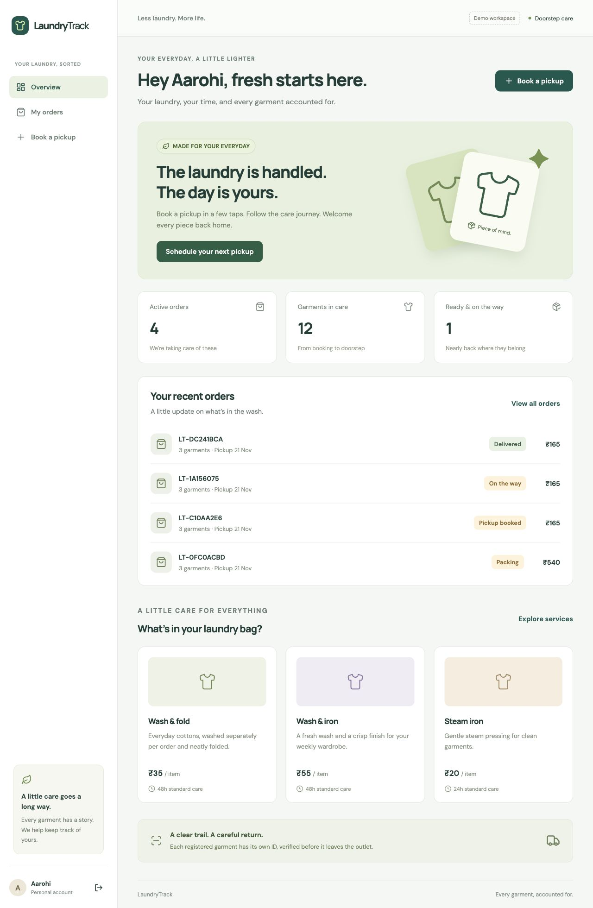

# LaundryTrack

**A clear trail for every garment — from pickup to the customer’s doorstep.**

LaundryTrack is a JavaScript major-project pilot for one laundry outlet. Customers book itemised doorstep care; staff record custody, label individual garments, verify packing and acknowledge full or partial returns. Android/iOS and web share the same authenticated API and database.

[](https://github.com/samiksha-jangid27/LaundryTrack/actions/workflows/ci.yml)



## Run the project

Use Node **22.18 or later**, and npm. Run everything below from the repository root.

```sh
npm ci
npm run demo
```

Open **http://localhost:5173**. Demo mode seeds fictional customer, staff and owner accounts on first launch. Use the three demo buttons, or:

| View        | Email                        | Password          |
| ----------- | ---------------------------- | ----------------- |
| Customer    | `customer@laundrytrack.demo` | `FreshStart!2026` |
| Outlet team | `staff@laundrytrack.demo`    | `FreshStart!2026` |
| Owner       | `owner@laundrytrack.demo`    | `FreshStart!2026` |

**Demo accounts are public sample credentials. Enable demo mode only for fictional data in a local or isolated demonstration.** `npm run dev` starts without automatically creating demo accounts; it does not remove accounts already seeded in the selected database. Use a separate, empty database for real data.

## Run Android / iOS

Keep the API running, then:

```sh
npm run mobile
```

Open the project in a matching **Expo SDK 58** client, or create a development build. A physical phone and laptop must share Wi-Fi. The app infers the development server’s LAN address when Expo provides it. If it cannot connect, open **API connection settings** on the sign-in screen:

| Device           | API address                        |
| ---------------- | ---------------------------------- |
| Physical phone   | `http://YOUR_COMPUTER_LAN_IP:4000` |
| Android emulator | `http://10.0.2.2:4000`             |
| iOS simulator    | `http://localhost:4000`            |

Alternatively copy `mobile/.env.example` to `mobile/.env` and set `EXPO_PUBLIC_API_URL`. This is public configuration, never a place for credentials. Restart Metro after changing it.

Build profiles and local build commands: [mobile build guide](docs/MOBILE.md). A JavaScript export is distinct from a signed installable application.

## What works

- Customer registration, sign-in, itemised booking, saved prices, pickup slots and care notes.
- Separate customer, staff and owner permissions enforced by the API.
- Counted pickup receipt; per-garment type, colour, existing-mark note and opaque QR identifier at intake.
- Ordered cleaning/quality/packing/delivery stages with an actor-stamped event history.
- **Packing reconciliation:** reject wrong-order and repeated scans; block readiness until every registered garment is verified.
- Customer-only delivery-code generation, code-verified handoffs and partial returns with remaining garments still open.
- Customer issues and recorded outlet resolutions.
- Native SQLite order cache and pending packing scans; ordered retries, stable event IDs and explicit version conflicts.
- Outlet workload insights and owner-only CSV export. Booked values are explicitly separated from collected payments.
- A small completion-time regression demonstration with a chronological holdout and service-duration baseline. Its synthetic-data limits are visible in the UI.

## Repository

```text
mobile/          Expo SDK 58, React Native, Expo Router — JavaScript
web/             React + Vite customer/outlet workspace
server/          Express API, Node SQLite, sessions, custody rules
packages/core/   Shared Zod validation, status names and QR format
scripts/         Reproducible branding and local preview helpers
docs/            Architecture, API, demo walkthrough and test evidence
```

The default database is always `server/data/laundrytrack.sqlite`, regardless of the launch directory. Override it with `DATABASE_PATH`. SQLite transactions and version checks keep the single-outlet pilot easy to run; multiple API replicas would need coordinated storage, migrations and a shared rate limiter.

## Verify

```sh
npm run check           # ESLint, JavaScript syntax/module check, tests, production web build
npm run mobile:export   # Android/iOS Hermes bundles and React Native web export
npm run model:evaluate # Reproducible synthetic-data evaluation
npm audit --omit=dev
```

The project deliberately uses JavaScript. `typecheck` parses the JavaScript/JSX project with TypeScript’s no-emit checker; it does **not** make this a fully typed TypeScript codebase.

CI runs tests and bundles on pushes and pull requests. [Validation evidence and limits](docs/VALIDATION.md) distinguish automated tests, browser checks and device checks.

## Documentation

- [Walk through a complete order](docs/DEMO.md)
- [Architecture and data integrity](docs/ARCHITECTURE.md)
- [API reference](docs/API.md)
- [Native builds and local connectivity](docs/MOBILE.md)
- [Completion estimate experiment](docs/ML.md)
- [Real-data setup and operating limits](docs/OPERATIONS.md)

Delivery tracking is a status and custody timeline. Payments are settled directly with the outlet. This pilot does not integrate live GPS, payment collection, SMS, maps, or an external laundry business. Physical tags must be wash-safe and validated with an outlet before operational use.
