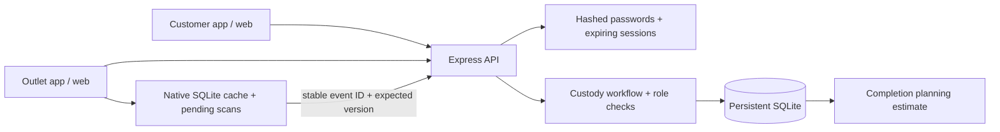

# Architecture

## Data model

`users` own customer orders. `sessions` hold SHA-256 hashes of random bearer tokens, not raw tokens. Passwords use salted scrypt and constant-time comparison. Public registration always creates a customer; owner/staff accounts are provisioned by a local administrative script.

`orders` contain pickup/address details, expected and collected counts, status and version. `order_items` snapshot service names, units and integer-paise prices. Updating the catalog does not silently change an existing receipt.

`garments` belong to exactly one order, with separate packed and returned flags. The QR payload contains only `laundrytrack:garment:<opaque UUID>`. A garment ID is separate from the order number; this pilot does not have reusable bag identities.

`events` record the actor, event kind, description and timestamp. The API exposes no event-edit/delete endpoint. This is application-level audit history, not a cryptographically tamper-proof ledger.

`actions` store mutation IDs, actor, order, operation, request hash and original response. `booking_requests` do the same for booking retries. `issues` retain the customer’s complaint and the outlet’s response.

## Custody invariants

1. An uncollected order can be cancelled. A cancelled/delivered order cannot advance.
2. Collection requires the physical count to match the agreed booking.
3. Intake cannot register more than the collected count, and processing cannot start with an incomplete manifest.
4. A packing scan must identify an unscanned garment belonging to this order.
5. Ready requires all garments packed; leaving for delivery preserves those flags.
6. A handoff requires the customer’s active code and explicitly selected, packed, unreturned garments.
7. A partial return records those garments and keeps the order out for delivery until all are returned.

Mutations run inside `BEGIN IMMEDIATE` transactions with rollback on error. The expected order version rejects stale writes. A successful action and its replay record commit together; retrying the same request returns its first result. Reusing an action ID for another actor/body/operation is rejected.

The synchronous SQLite driver suits a small single-process outlet pilot. Password hashing blocks the process briefly; larger deployments should use a worker pool or an asynchronous password service and a database designed for their concurrency needs.

## Offline behavior

Mobile caches data under the signed-in user’s ID. Tokens use SecureStore on native platforms. Native cached orders and pending scans use SQLite; the React Native web preview uses sessionStorage.

Only packing scans are queued. Bookings, delivery acknowledgement and other custody changes need the API. A queued scan retains its event ID and expected version. The queue is sent sequentially and removes only confirmed actions. A network or version error stops replay; the app shows saved work for review instead of silently overwriting server state. Pending scans do not count as server-verified packing. Signing out clears local data and requires pending work to be synced or explicitly discarded first.

SQLite caches are not an encrypted database. A real deployment needs a device retention/encryption policy appropriate to its customer data. The pilot does not cache photographs.
