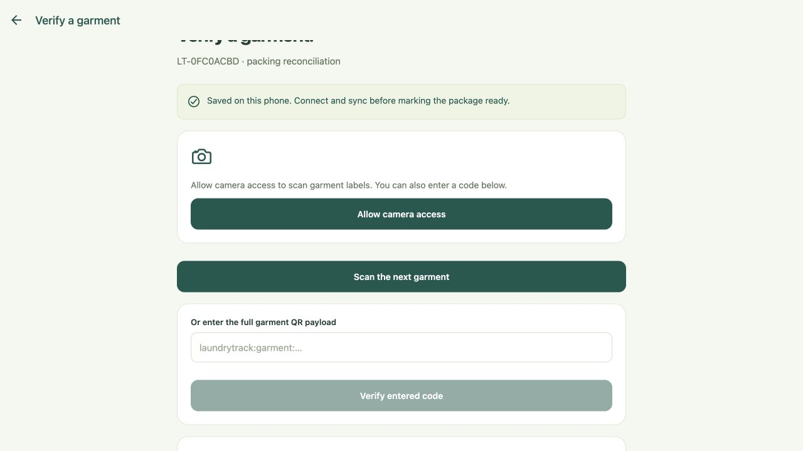

# Validation record

Date: **21 November 2026**. Source and screenshots use fictional demo records.

| Check                                       | Result / evidence                                                                                                                                                                                     |
| ------------------------------------------- | ----------------------------------------------------------------------------------------------------------------------------------------------------------------------------------------------------- |
| Automated tests                             | 19 passing across API permissions, sessions, booking snapshots/retries, pickup/intake/packing invariants, partial delivery, issues, queue replay, synthetic-model evaluation and atomic demo recovery |
| JavaScript quality                          | ESLint and no-emit JavaScript/JSX syntax/module check passed; this is not a fully typed TypeScript project                                                                                            |
| Web production build                        | Vite build passed; built web app also served successfully from the Express API                                                                                                                        |
| Expo Doctor                                 | 20/20 checks passed                                                                                                                                                                                   |
| Android export                              | Hermes bundle generated successfully                                                                                                                                                                  |
| iOS export                                  | Hermes bundle generated successfully                                                                                                                                                                  |
| React Native web export                     | Static export passed; customer/staff routes exercised in the browser                                                                                                                                  |
| Native Android                              | `:app:assembleRelease` passed for ARM64; APK signature and manifest verified                                                                                                                          |
| APK permissions                             | Camera, internet, network-state and the app-private receiver permission; storage/overlay/audio/biometric permissions removed                                                                          |
| iOS dependencies                            | CocoaPods install completed with native modules and code generation                                                                                                                                   |
| Native iOS                                  | **Not verified.** xcodebuild reported workspace recognition errors and CoreSimulator service connection failures in this environment                                                                  |
| Physical-device camera and wash-safe labels | **Not performed.** Requires a real phone and an outlet/material pilot                                                                                                                                 |

## Browser checks performed

- Customer demo sign-in and dashboard.
- Two-item booking submitted from the web: ₹70 receipt, generated order and private return code.
- Staff sign-in, role-specific navigation, manifest/QR labels and correct assignment selection.
- Marking an incomplete package ready was blocked.
- Correct garment scan succeeded; scanning the same garment again was rejected.
- Removing a packed piece for recheck and scanning it again worked.
- React Native customer overview at a 390 × 844 phone breakpoint; order receipt, care timeline, account and staff navigation.
- Customer-only delivery-code generation from the React Native web preview, backed by the actual API.
- **Offline transport check:** loaded the staff manifest, stopped the API process, entered a valid unscanned garment code and observed one saved pending scan. Restarted the API and synced: one action confirmed, zero pending, packing count increased from one to two. This exercised the browser adapter and real HTTP transport, not native SQLite or a physical camera.

## Android artifact

The pilot APK is `LaundryTrack-pilot-arm64.apk` in the GitHub pilot release. Its SHA-256, exact size, source revision, ABI, SDK levels, signing status and permissions are recorded in [ANDROID-BUILD.json](ANDROID-BUILD.json).

It is **debug-signed** for project demonstration, with release-mode bundled JavaScript. It needs a running LaundryTrack API; it is not an independently hosted laundry service or a store-distributed production build. Native device launch, camera decoding and real-device SQLite/SecureStore behavior are pending checks.

## Boundaries

No claim is made about real customers served, measured garment-loss reduction, load capacity, validated delivery prediction, payment settlement, push/SMS delivery, GPS accuracy or physical label durability. All completion-model metrics describe the explicitly synthetic experiment. A successful bundle/build is recorded separately from device/runtime validation.
